# artagram-feed

Microservicio de Feed, Publicaciones, Versiones, Comentarios y Likes para ArtaGram.

## Tecnologías
- Java 21, Spring Boot 3.3.4
- Spring Data JPA + PostgreSQL (`db_feed`)
- Spring Data Redis (Caché en Redis db 1)
- Spring AMQP (RabbitMQ: publica `post.published`, `like.updated`, `comment.created`, etc.)
- AWS SDK v2 para almacenamiento de imágenes en S3/MinIO con URLs prefirmadas

## Endpoints
- `GET /api/publicaciones`
- `GET /api/publicaciones/{id}`
- `POST /api/publicaciones`
- `PUT /api/publicaciones/{id}`
- `DELETE /api/publicaciones/{id}`
- `POST /api/publicaciones/{id}/like`
- `GET /api/publicaciones/{id}/comentarios`
- `POST /api/publicaciones/{id}/comentarios`
- `DELETE /api/publicaciones/{id}/comentarios/{comentarioId}`
- `GET /api/publicaciones/{id}/versiones`
- `POST /api/publicaciones/{id}/versiones`
- `GET /api/feed/siguiendo`
- `GET /api/feed/explorar`
- `POST /api/media/presign`
- `GET /media/**`
- `GET /api/publicaciones/{id}/analisis`
- `POST /api/publicaciones/{id}/analisis`
- `POST /api/ia/sugerencias`

## Variables de Entorno
Ver `.env.example`.

## Diseño y Arquitectura

### Diagrama de clases (núcleo)

### Descripción

Arquitectura en capas clásica (`controller` → `service` → `domain`/`repository`), con dos
puntos de abstracción explícitos: almacenamiento de media (`storage`) y mensajería de
eventos de dominio (`events`). No hay lógica de negocio en los controladores — solo
resuelven el usuario autenticado (`JwtUserResolver`) y delegan.

### Principios SOLID

- **SRP (bien aplicado):** cada `*Service` cubre un solo agregado (`PublicacionService`,
  `ComentarioService`, `AnalisisIaService`, `VersionService`). `StorageService` separa la
  resolución de rutas/URLs públicas de la implementación física del almacenamiento.
- **OCP (el punto más fuerte del servicio):** `StorageProvider` es una interfaz con dos
  implementaciones intercambiables por configuración (`DiskStorageProvider` /
  `S3StorageProvider`, activadas vía `@ConditionalOnProperty(artagram.storage.type)`).
  Agregar un tercer backend (p. ej. Azure Blob, como ya existe en `ARTAGRAM-backv1`) no
  requiere tocar `StorageService` ni ningún controlador — es el ejemplo de texto del
  principio Abierto/Cerrado en este codebase.
- **LSP:** ambas implementaciones de `StorageProvider` son verdaderamente
  intercambiables; los métodos opcionales (`urlPrefirmadaSubida/Lectura`) usan `default
  Optional.empty()` en la interfaz en vez de forzar a `DiskStorageProvider` a lanzar
  `UnsupportedOperationException`, lo cual respeta la sustituibilidad.
- **ISP:** la interfaz `StorageProvider` es pequeña y cohesiva (5 operaciones). No hay
  "god interfaces" en el servicio.
- **DIP (mejorable):** `PublicacionService` depende de **7** colaboradores inyectados
  por constructor (`PublicacionRepository`, `VersionPublicacionRepository`,
  `LikePublicacionRepository`, `UsuarioProyeccionRepository`,
  `SeguidorProyeccionRepository`, `StorageService`, `FeedEventPublisher`) y mezcla
  cuatro responsabilidades de lectura/escritura (CRUD de publicaciones, likes, feed
  "siguiendo", feed "explorar", construcción de DTO). Es el candidato más claro a
  partirse: un `LikeService` y un `FeedQueryService` separados reducirían el
  acoplamiento y harían más fácil testear cada flujo de forma aislada sin tocar los
  demás. Las entidades (`Publicacion`, etc.) no implementan ninguna interfaz de dominio
  — es un modelo anémico típico de Spring Data, consistente en todo el proyecto.

### Extensibilidad real

- **Nuevo backend de almacenamiento:** implementar `StorageProvider` + anotar con
  `@ConditionalOnProperty(name = "artagram.storage.type", havingValue = "...")`. Cero
  cambios en `StorageService` o en los controladores.
- **Nuevos eventos de dominio:** `FeedEventPublisher` centraliza todas las publicaciones
  a RabbitMQ (`post.published`, `like.updated`, `comment.created`, `comment.deleted`,
  `ai.analyze`); agregar un evento nuevo es un método más ahí, sin tocar los services que
  ya lo usan.
- **Orden de feed:** `listar()` ya resuelve por parámro (`tag`, `busqueda`,
  `"populares"`, por defecto reciente) — agregar un criterio nuevo es una rama más, pero
  al crecer convendría un patrón Strategy (`FeedSortStrategy`) en vez de `if/else`.

### Preparación para AWS

- **Datastore:** `db_feed` (Postgres) → **RDS PostgreSQL** (Multi-AZ para prod); la
  cadena de conexión ya es 100% parametrizada por `DB_HOST/DB_PORT/DB_NAME/DB_USER/DB_PASSWORD`,
  sin cambios de código.
- **Caché:** Redis db 1 (caché de feed) → **ElastiCache for Redis**; mismo patrón de
  env vars (`REDIS_HOST/REDIS_PORT`). Ya está lógicamente aislado en su propia "db" Redis,
  así que migrar a una instancia ElastiCache dedicada (sin bases lógicas compartidas) es
  directo.
- **Mensajería:** RabbitMQ → **Amazon MQ for RabbitMQ** es el camino de menor fricción
  (protocolo AMQP 0-9-1 idéntico, solo cambia host/credenciales). Migrar a SNS/SQS
  exigiría reescribir `FeedRabbitMqConfig`/`FeedEventPublisher`/`FeedEventListener`.
- **Almacenamiento de media:** `S3StorageProvider` ya usa el SDK v2 real de AWS — en
  AWS basta con quitar `endpointOverride` (dejar `S3_ENDPOINT` vacío) y usar credenciales
  de un **IAM role** (vía `DefaultCredentialsProvider`) en vez de `access-key`/`secret-key`
  explícitas; hoy estas llegan por env var, lo cual funciona pero no es la práctica
  recomendada en AWS (mejor **IAM roles for ECS tasks/EKS service accounts** +
  **Secrets Manager** para cualquier secreto que deba persistir, como `JWT_PUBLIC_KEY_PATH`
  — hoy es un archivo montado, en AWS conviene resolverlo desde Secrets Manager o Parameter
  Store en el arranque).
- **Stateless / escalado horizontal:** el servicio no guarda sesión en memoria del
  proceso (JWT estilo stateless + caché en Redis compartido) — es seguro correr N réplicas
  detrás de un ALB/ECS Service sin sticky sessions.
- **Cómputo:** encaja bien en **ECS Fargate** (un contenedor, sin estado local salvo el
  `STORAGE_LOCAL_DIR` de fallback en disco que solo aplica si `STORAGE_TYPE=disk` — en AWS
  siempre debe ser `s3`, nunca `disk`, para no depender del filesystem efímero del
  contenedor).

## Descripción del servicio

`artagram-feed` es el microservicio responsable del núcleo social de ArtaGram: las
publicaciones (obras), sus versiones/proceso creativo, los likes, los comentarios y el
feed (siguiendo/explorar). Existe como servicio separado porque encapsula un dominio con
su propio ciclo de vida de datos (`db_feed` en PostgreSQL) y un patrón de carga muy
distinto al de otros servicios del sistema: escribe imágenes pesadas hacia S3/MinIO a
través de URLs prefirmadas, lee en alto volumen para construir feeds paginados, y produce
y consume eventos de dominio (RabbitMQ) para mantener sincronizadas proyecciones locales
de usuarios y seguidores sin necesidad de llamar síncronamente al servicio de usuarios en
cada request. Al aislar esta responsabilidad, el servicio puede escalar horizontalmente
de forma independiente (es *stateless*: no guarda sesión, valida el JWT localmente) y
evolucionar su modelo de almacenamiento o su esquema de base de datos sin acoplarse al
resto de los microservicios de ArtaGram.

## Responsabilidades

- CRUD de publicaciones (crear, listar con filtros de `tag`/búsqueda/orden, obtener,
  editar, eliminar) con reglas de autoría/admin (`PublicacionController` /
  `PublicacionService`).
- Toggle de "me gusta" sobre una publicación, manteniendo un contador denormalizado
  (`contadorLikes`) en `Publicacion` para evitar `COUNT` costosos en el feed.
- Comentarios sobre publicaciones: crear, listar y eliminar, con permisos de autor del
  comentario, autor de la publicación o administrador (`ComentarioService`).
- Versionado de una publicación (historial de imágenes del proceso creativo, p. ej. bocetos
  previos a la obra final) vía `VersionService`/`VersionPublicacionRepository`.
- Construcción de los feeds "siguiendo" (a partir de la proyección local de seguidores,
  `SeguidorProyeccionRepository`) y "explorar" (orden por popularidad/recencia).
- Abstracción y gestión del almacenamiento de media: generación de URLs prefirmadas de
  subida/lectura en S3 (`StorageService` + `S3StorageProvider`), con una implementación en
  disco (`DiskStorageProvider`) usada en desarrollo/pruebas cuando `STORAGE_TYPE=disk`.
- Resolución del usuario autenticado sin llamar síncronamente al servicio de autenticación:
  o bien confía en los headers inyectados por el gateway (`X-User-Id`, `X-User-Roles`), o
  valida la firma de un JWT con una llave pública RSA cargada localmente desde archivo PEM
  o variable de entorno (`JwtUserResolver` + `RsaTokenValidator`).
- Publicación de eventos de dominio hacia RabbitMQ (`post.published`, `like.updated`,
  `like.created`, `comment.created`, `comment.deleted`, `ai.analyze`) vía
  `FeedEventPublisher`.
- Consumo de eventos externos (`user.registered`, `user.deleted`, `follow.created`,
  `follow.deleted`, `media.processed`, `ai.completed`) para mantener actualizadas las
  proyecciones locales de usuario/seguidor y enriquecer publicaciones con miniatura,
  blurhash y resultados de análisis IA generados por un worker externo
  (`FeedEventListener`).
- Exposición de resultados de análisis de IA sobre una obra y sugerencia de etiquetas
  (`AnalisisIaService`), delegando el cómputo pesado a otro servicio vía eventos
  asíncronos en vez de hacerlo en el propio feed.
- Carga de datos semilla para entornos de desarrollo (`FeedDataSeeder`).

## Diagrama de clases

```mermaid
classDiagram
    class PublicacionController
    class ComentarioController
    class VersionController
    class AnalisisIaController
    class MediaController
    class FeedController

    class PublicacionService
    class ComentarioService
    class VersionService
    class AnalisisIaService

    class JwtUserResolver
    class RsaTokenValidator

    class StorageService
    class StorageProvider {
        <<interface>>
    }
    class DiskStorageProvider
    class S3StorageProvider

    class FeedEventPublisher
    class FeedEventListener
    class FeedRabbitMqConfig

    class PublicacionRepository {
        <<interface>>
    }
    class ComentarioPublicacionRepository {
        <<interface>>
    }
    class LikePublicacionRepository {
        <<interface>>
    }
    class VersionPublicacionRepository {
        <<interface>>
    }
    class AnalisisIaRepository {
        <<interface>>
    }
    class UsuarioProyeccionRepository {
        <<interface>>
    }
    class SeguidorProyeccionRepository {
        <<interface>>
    }

    class Publicacion
    class ComentarioPublicacion
    class LikePublicacion
    class VersionPublicacion
    class AnalisisIa
    class UsuarioProyeccion
    class SeguidorProyeccion

    PublicacionController --> PublicacionService
    PublicacionController --> JwtUserResolver
    ComentarioController --> ComentarioService
    ComentarioController --> JwtUserResolver
    VersionController --> VersionService
    VersionController --> JwtUserResolver
    AnalisisIaController --> AnalisisIaService
    AnalisisIaController --> JwtUserResolver
    MediaController --> StorageService
    MediaController --> JwtUserResolver
    FeedController --> PublicacionService
    FeedController --> JwtUserResolver

    JwtUserResolver --> RsaTokenValidator

    PublicacionService --> PublicacionRepository
    PublicacionService --> VersionPublicacionRepository
    PublicacionService --> LikePublicacionRepository
    PublicacionService --> UsuarioProyeccionRepository
    PublicacionService --> SeguidorProyeccionRepository
    PublicacionService --> StorageService
    PublicacionService --> FeedEventPublisher

    ComentarioService --> ComentarioPublicacionRepository
    ComentarioService --> PublicacionRepository
    ComentarioService --> UsuarioProyeccionRepository
    ComentarioService --> FeedEventPublisher

    VersionService --> VersionPublicacionRepository
    VersionService --> PublicacionRepository
    VersionService --> StorageService

    AnalisisIaService --> AnalisisIaRepository
    AnalisisIaService --> PublicacionRepository
    AnalisisIaService --> FeedEventPublisher

    StorageService --> StorageProvider
    StorageProvider <|.. DiskStorageProvider
    StorageProvider <|.. S3StorageProvider

    FeedEventPublisher --> FeedRabbitMqConfig
    FeedEventListener --> FeedRabbitMqConfig
    FeedEventListener --> UsuarioProyeccionRepository
    FeedEventListener --> SeguidorProyeccionRepository
    FeedEventListener --> PublicacionRepository
    FeedEventListener --> AnalisisIaRepository

    PublicacionRepository ..> Publicacion
    ComentarioPublicacionRepository ..> ComentarioPublicacion
    LikePublicacionRepository ..> LikePublicacion
    VersionPublicacionRepository ..> VersionPublicacion
    AnalisisIaRepository ..> AnalisisIa
    UsuarioProyeccionRepository ..> UsuarioProyeccion
    SeguidorProyeccionRepository ..> SeguidorProyeccion

    Publicacion "1" --> "1" UsuarioProyeccion : autor
    ComentarioPublicacion "1" --> "1" Publicacion
    ComentarioPublicacion "1" --> "1" UsuarioProyeccion : autor
    LikePublicacion "1" --> "1" Publicacion
    LikePublicacion "1" --> "1" UsuarioProyeccion : usuario
    VersionPublicacion "1" --> "1" Publicacion
    AnalisisIa "1" --> "1" Publicacion
```

> **Nota — configuración de Redis muerta:** `application.yml` declara
> `spring.data.redis` (host/puerto/`database: 1`/timeout) y el README original de este
> servicio incluso la documenta como "caché de feed". Sin embargo, al buscar
> `Redis`/`RedisTemplate`/`RedisCacheManager` en `src/main/java` el resultado es **cero
> coincidencias**: ninguna clase del servicio usa Redis. Es configuración heredada de una
> plantilla común a los microservicios de ArtaGram, nunca conectada a código real en
> `artagram-feed`. Lo mismo ocurre con `artagram.jwt.jwks-url`: existe en el YAML pero
> ningún componente (`RsaTokenValidator` incluido) lo lee — la validación de JWT se hace
> hoy exclusivamente contra una llave pública RSA estática (archivo PEM o variable de
> entorno), no contra un endpoint JWKS. Ver el escenario de Modificabilidad abajo.

## Atributos de calidad

### Modificabilidad — configuración muerta que sugiere una capacidad inexistente

- **Fuente:** un desarrollador nuevo en el equipo que necesita ajustar o depurar el
  comportamiento de caché del feed.
- **Estímulo:** lee `spring.data.redis` en `application.yml` (y la mención de "caché en
  Redis db 1" en la documentación existente) y asume que el feed cachea resultados en
  Redis, por lo que intenta modificar un TTL de caché o depurar un supuesto problema de
  invalidación.
- **Artefacto:** `artagram-feed` (`application.yml` + ausencia total de
  `RedisTemplate`/`@Cacheable`/`CacheManager` en `src/main/java`).
- **Ambiente:** desarrollo/mantenimiento, antes de desplegar un cambio.
- **Respuesta:** tras buscar en el código (`grep -r Redis src/main/java`), el
  desarrollador confirma que no existe ninguna clase que use Redis; la configuración es
  vestigial de una plantilla compartida y no tiene efecto alguno en el comportamiento del
  servicio. El tiempo "perdido" depurando una caché que no existe se convierte en
  confusión evitable, y el riesgo crece si alguien llega a creer que ya hay caché y omite
  implementarla donde sí haría falta (p. ej. en `feedExplorar`, que hoy golpea Postgres en
  cada llamada).
- **Medida de respuesta:** el hallazgo es verificable en menos de 1 minuto con un solo
  `grep`; cero clases Java referencian Redis (confirmado); se recomienda que el equipo
  elimine el bloque `spring.data.redis` de `application.yml` o implemente realmente la
  caché — cualquiera de las dos opciones reduce a cero la probabilidad de que un futuro
  mantenedor asuma una capacidad que no existe.

### Seguridad — validación de JWT local sin llamar al servicio de autenticación

- **Fuente:** una petición de un cliente (a través del gateway) con un header
  `Authorization: Bearer <token>`.
- **Estímulo:** la petición llega a un endpoint protegido (p. ej. `POST
  /api/publicaciones`) y el servicio de autenticación está caído, lento, o simplemente no
  se quiere acoplar el feed a su disponibilidad.
- **Artefacto:** `JwtUserResolver` y `RsaTokenValidator`.
- **Ambiente:** operación normal en producción, con múltiples réplicas del feed detrás de
  un balanceador.
- **Respuesta:** `RsaTokenValidator` carga una sola vez (`@PostConstruct`) la llave
  pública RSA (desde `JWT_PUBLIC_KEY_PEM` o un archivo PEM) y verifica la firma del JWT en
  memoria con `io.jsonwebtoken`, sin ninguna llamada de red al servicio de autenticación
  para validar el token en cada request.
- **Medida de respuesta:** cero llamadas salientes a `auth-service` por petición
  autenticada; la validación es una operación criptográfica local (firma RSA), por lo que
  el feed sigue respondiendo peticiones autenticadas incluso si el servicio de
  autenticación está completamente caído — el acoplamiento en tiempo de ejecución entre
  ambos servicios es nulo.

### Confiabilidad — manejo de fallos al consumir eventos asíncronos

- **Fuente:** un evento RabbitMQ con un payload inesperado (campo nulo, id de publicación
  que ya no existe, tipo de dato incorrecto) publicado por otro microservicio.
- **Estímulo:** `FeedRabbitMqConfig` entrega el mensaje a uno de los métodos
  `@RabbitListener` de `FeedEventListener` (`onUserRegistered`, `onFollowCreated`,
  `onMediaProcessed`, `onAiCompleted`, etc.) y el procesamiento lanza una excepción en
  tiempo de ejecución.
- **Artefacto:** `FeedEventListener`.
- **Ambiente:** operación normal en producción, con flujo continuo de eventos entre los
  microservicios desacoplados de ArtaGram.
- **Respuesta:** cada método de `FeedEventListener` envuelve toda su lógica en un
  `try/catch (Exception ex)` que solo registra `log.error(...)` y retorna
  normalmente, sin volver a lanzar la excepción.
- **Medida de respuesta:** el mensaje se confirma (ACK) igual ante RabbitMQ aunque el
  procesamiento haya fallado, por lo que un evento "envenenado" nunca bloquea la cola ni
  provoca reintentos infinitos — a costa de que ese evento específico se pierda en
  silencio, ya que hoy no existe ningún mecanismo visible de reintento ni de dead-letter
  queue (DLQ) en el código para recuperarlo.
