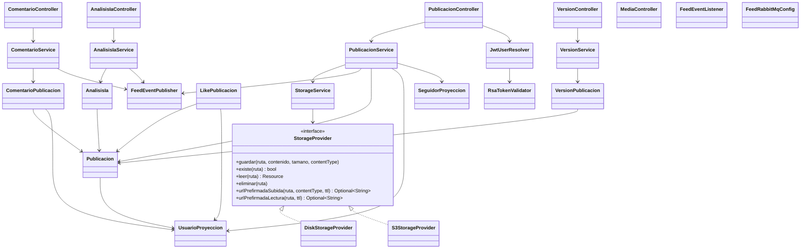

# artagram-feed

Microservicio de Feed, Publicaciones, Versiones, Comentarios y Likes para ArtaGram.

## Tecnologías
- Java 21, Spring Boot 3.3.4
- Spring Data JPA + PostgreSQL (`db_feed`)
- Spring Data Redis (Caché en Redis db 1)
- Spring AMQP (RabbitMQ: publica `post.published`, `like.updated`, `comment.created`, etc.)
- AWS SDK v2 para almacenamiento de imágenes en S3/MinIO con URLs prefirmadas

## Endpoints
- `GET /api/publicaciones`
- `GET /api/publicaciones/{id}`
- `POST /api/publicaciones`
- `PUT /api/publicaciones/{id}`
- `DELETE /api/publicaciones/{id}`
- `POST /api/publicaciones/{id}/like`
- `GET /api/publicaciones/{id}/comentarios`
- `POST /api/publicaciones/{id}/comentarios`
- `DELETE /api/publicaciones/{id}/comentarios/{comentarioId}`
- `GET /api/publicaciones/{id}/versiones`
- `POST /api/publicaciones/{id}/versiones`
- `GET /api/feed/siguiendo`
- `GET /api/feed/explorar`
- `POST /api/media/presign`
- `GET /media/**`
- `GET /api/publicaciones/{id}/analisis`
- `POST /api/publicaciones/{id}/analisis`
- `POST /api/ia/sugerencias`

## Variables de Entorno
Ver `.env.example`.

## Diseño y Arquitectura

### Diagrama de clases (núcleo)

### Descripción

Arquitectura en capas clásica (`controller` → `service` → `domain`/`repository`), con dos
puntos de abstracción explícitos: almacenamiento de media (`storage`) y mensajería de
eventos de dominio (`events`). No hay lógica de negocio en los controladores — solo
resuelven el usuario autenticado (`JwtUserResolver`) y delegan.

### Principios SOLID

- **SRP (bien aplicado):** cada `*Service` cubre un solo agregado (`PublicacionService`,
  `ComentarioService`, `AnalisisIaService`, `VersionService`). `StorageService` separa la
  resolución de rutas/URLs públicas de la implementación física del almacenamiento.
- **OCP (el punto más fuerte del servicio):** `StorageProvider` es una interfaz con dos
  implementaciones intercambiables por configuración (`DiskStorageProvider` /
  `S3StorageProvider`, activadas vía `@ConditionalOnProperty(artagram.storage.type)`).
  Agregar un tercer backend (p. ej. Azure Blob, como ya existe en `ARTAGRAM-backv1`) no
  requiere tocar `StorageService` ni ningún controlador — es el ejemplo de texto del
  principio Abierto/Cerrado en este codebase.
- **LSP:** ambas implementaciones de `StorageProvider` son verdaderamente
  intercambiables; los métodos opcionales (`urlPrefirmadaSubida/Lectura`) usan `default
  Optional.empty()` en la interfaz en vez de forzar a `DiskStorageProvider` a lanzar
  `UnsupportedOperationException`, lo cual respeta la sustituibilidad.
- **ISP:** la interfaz `StorageProvider` es pequeña y cohesiva (5 operaciones). No hay
  "god interfaces" en el servicio.
- **DIP (mejorable):** `PublicacionService` depende de **7** colaboradores inyectados
  por constructor (`PublicacionRepository`, `VersionPublicacionRepository`,
  `LikePublicacionRepository`, `UsuarioProyeccionRepository`,
  `SeguidorProyeccionRepository`, `StorageService`, `FeedEventPublisher`) y mezcla
  cuatro responsabilidades de lectura/escritura (CRUD de publicaciones, likes, feed
  "siguiendo", feed "explorar", construcción de DTO). Es el candidato más claro a
  partirse: un `LikeService` y un `FeedQueryService` separados reducirían el
  acoplamiento y harían más fácil testear cada flujo de forma aislada sin tocar los
  demás. Las entidades (`Publicacion`, etc.) no implementan ninguna interfaz de dominio
  — es un modelo anémico típico de Spring Data, consistente en todo el proyecto.

### Extensibilidad real

- **Nuevo backend de almacenamiento:** implementar `StorageProvider` + anotar con
  `@ConditionalOnProperty(name = "artagram.storage.type", havingValue = "...")`. Cero
  cambios en `StorageService` o en los controladores.
- **Nuevos eventos de dominio:** `FeedEventPublisher` centraliza todas las publicaciones
  a RabbitMQ (`post.published`, `like.updated`, `comment.created`, `comment.deleted`,
  `ai.analyze`); agregar un evento nuevo es un método más ahí, sin tocar los services que
  ya lo usan.
- **Orden de feed:** `listar()` ya resuelve por parámro (`tag`, `busqueda`,
  `"populares"`, por defecto reciente) — agregar un criterio nuevo es una rama más, pero
  al crecer convendría un patrón Strategy (`FeedSortStrategy`) en vez de `if/else`.

### Preparación para AWS

- **Datastore:** `db_feed` (Postgres) → **RDS PostgreSQL** (Multi-AZ para prod); la
  cadena de conexión ya es 100% parametrizada por `DB_HOST/DB_PORT/DB_NAME/DB_USER/DB_PASSWORD`,
  sin cambios de código.
- **Caché:** Redis db 1 (caché de feed) → **ElastiCache for Redis**; mismo patrón de
  env vars (`REDIS_HOST/REDIS_PORT`). Ya está lógicamente aislado en su propia "db" Redis,
  así que migrar a una instancia ElastiCache dedicada (sin bases lógicas compartidas) es
  directo.
- **Mensajería:** RabbitMQ → **Amazon MQ for RabbitMQ** es el camino de menor fricción
  (protocolo AMQP 0-9-1 idéntico, solo cambia host/credenciales). Migrar a SNS/SQS
  exigiría reescribir `FeedRabbitMqConfig`/`FeedEventPublisher`/`FeedEventListener`.
- **Almacenamiento de media:** `S3StorageProvider` ya usa el SDK v2 real de AWS — en
  AWS basta con quitar `endpointOverride` (dejar `S3_ENDPOINT` vacío) y usar credenciales
  de un **IAM role** (vía `DefaultCredentialsProvider`) en vez de `access-key`/`secret-key`
  explícitas; hoy estas llegan por env var, lo cual funciona pero no es la práctica
  recomendada en AWS (mejor **IAM roles for ECS tasks/EKS service accounts** +
  **Secrets Manager** para cualquier secreto que deba persistir, como `JWT_PUBLIC_KEY_PATH`
  — hoy es un archivo montado, en AWS conviene resolverlo desde Secrets Manager o Parameter
  Store en el arranque).
- **Stateless / escalado horizontal:** el servicio no guarda sesión en memoria del
  proceso (JWT estilo stateless + caché en Redis compartido) — es seguro correr N réplicas
  detrás de un ALB/ECS Service sin sticky sessions.
- **Cómputo:** encaja bien en **ECS Fargate** (un contenedor, sin estado local salvo el
  `STORAGE_LOCAL_DIR` de fallback en disco que solo aplica si `STORAGE_TYPE=disk` — en AWS
  siempre debe ser `s3`, nunca `disk`, para no depender del filesystem efímero del
  contenedor).
